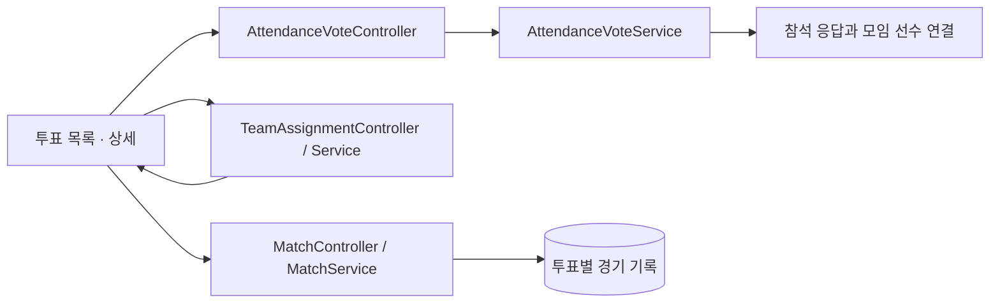

# 참석 투표와 팀 편성 연동

## 팀 확정 후 카드 위치

- 팀 확정이 완료된 일정(`matchId` 존재)은 운동 일정 투표 목록에서 제외하고 이전 경기 기록에 표시한다. 마감만 된 미확정 일정은 투표 목록에 남긴다.
- 경기 목록 응답의 `attendanceVote`에 제목·운동 날짜·장소·마감 시각을 포함한다. nullable to-one 연관을 함께 조회하며 페이지네이션은 유지한다. 신규 DB 마이그레이션은 필요하지 않다.
- 투표 목록과 경기 기록에서 `ExerciseScheduleCard`를 공유한다. 카드 본문은 참석·댓글 상세를 열고, ‘경기 기록 보기’는 당시 팀 구성을 연다. 기록에서 일정 상세로 이동했다가 뒤로 가면 경기 기록으로 돌아온다.
- 빠른 팀 편성 기록의 `attendanceVote`는 `null`이며 기존 경기 카드 표시를 유지한다.
- 회귀 검증은 일정 메타데이터·목록 페이지네이션·추가 쿼리 방지와 프론트엔드의 확정 여부별 분류 및 두 종류의 카드 렌더링을 포함한다.
- 이 변경의 경기 Service·Controller 테스트 17개, 프론트엔드 Node 테스트 24개와 lint가 통과했다. 실제 브라우저에서 클릭하는 검증은 별도로 수행하지 않았다.

- 모임장만 종료된 투표에서 편성을 시작한다. 서버는 참석 응답의 사용자 ID로 해당 모임의 활성 선수 ID를 찾고 누락·비활성 사유를 반환한다. 이름이 같아도 이름으로 선수를 연결하지 않는다.
- 모임장은 자동 선택된 참석자를 조정해 기존 편성 API와 검증을 사용한다. 기존 빠른 팀 편성은 투표 ID를 보내지 않는다.
- 경기 확정은 투표와 모임 관계, 모임장 권한, 종료 상태를 확인한다. 투표 행을 잠그고 `READ_COMMITTED` 트랜잭션에서 기존 기록을 확인하며, `matches.attendance_vote_id`의 고유 제약이 일정당 하나의 기록을 보장한다. 이미 확정된 경우 기존 기록을 반환한다.
- V12의 새 컬럼은 nullable이므로 기존 경기 기록은 그대로 유지된다. 투표 목록에 연결된 기록이 있으면 기록 보기로 이동한다.
- 팀 확정 화면은 저장한 경기의 상세 화면으로 이동한다. 목록의 경기 날짜는 기존 경기 기록과 같이 확정 시각을 기본값으로 사용한다.

## 검증 범위

- H2 테스트에서 계정·선수 매핑, 제외 사유, 권한, 투표 마감, 중복 및 동시 확정과 기존 빠른 편성을 검증한다.
- 실제 MySQL 동시성 확인은 `TEAMUP_VERIFY_ATTENDANCE_MYSQL=true`로 별도 실행할 수 있다. 실행한 경우 결과를 별도로 기록한다.
- 소셜 로그인부터 브라우저에서 버튼을 누르는 전체 사용자 흐름은 별도 확인이 필요하다.

- Docker MySQL 8.4?? V12 ??????? ?? ?? ?? ID? ?? ?? ???? ????. ??? ?? ?? 3?, ?? 24?, ?? 1?, ?? 3?? ? ?? ???? ????.
