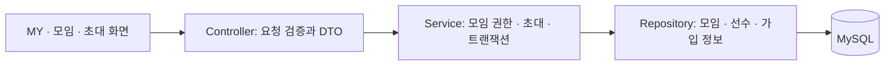

# 모임별 프로필 구현 기록

## 요청 흐름과 책임

- MY에서 모임으로 이동하거나 해당 모임의 본인 선수 정보를 직접 등록·수정한다.
- 새 모임 생성 시 모임장 선수 정보를 함께 입력받고 같은 트랜잭션에서 계정과 연결해 저장한다. 기존 모임에 연결된 모임장 선수가 없다면 선수 명단의 등록 버튼이나 MY에서 직접 등록한다.
- 모임원은 나이와 추가 사항을 포함한 선수 정보를 조회한다. 수정은 본인 또는 모임장에게만 허용하고, 모임원 본인은 `/members/me`를 이용한다.
- 초대받은 사용자는 로그인 후 미연결 활성 선수의 이름과 포지션을 확인하고 본인을 선택하거나 새 프로필을 등록한다. 초대 토큰을 가진 사람은 미연결 선수를 직접 선택할 수 있으므로, 초대 링크는 신뢰하는 사람에게만 공유해야 한다.
- 가입 시 모임과 초대, 선택한 선수 순서로 잠금을 획득하고 가입과 선수 연결을 한 트랜잭션으로 처리한다. 다른 모임의 선수, 비활성 선수, 이미 연결된 선수는 선택할 수 없다.
- V10은 `user_sport_profiles` 테이블과 공통 프로필 데이터를 삭제한다. `club_members`와 경기 기록은 삭제하지 않는다.

## 검증 범위

- 백엔드 회귀 테스트는 H2와 MockMvc에서 초대·권한·중복 선택·동시 선택 등을 확인한다. 별도 MySQL 동시성 테스트는 명시적으로 실행한 경우에만 검증된 것으로 본다.
- 프런트엔드 lint, 빌드와 Node 테스트를 실행했다. 실제 소셜 로그인과 사용자의 브라우저에서의 전체 가입 흐름은 별도 확인이 필요하다.
- 실행 중인 Docker MySQL에서 V10 적용과 백엔드 시작을 확인했다. 적용 전 공통 프로필은 0건이었고, 적용 전후 모임 2건·선수 21건·경기 1건으로 집계됐다. 건수 비교는 모든 데이터 값의 동일성을 검증하는 것은 아니다.
- API 계약은 [API 문서](./API.md)와 [OpenAPI](./openapi.json)에 반영한다.
