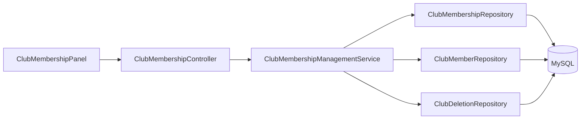

# 모임 탈퇴·삭제 및 모임장 관리 구현

요구사항: [확정된 작업 의도](./intent/club-membership-management.md).

## 구조와 책임

- Controller는 세션에서 사용자 ID를 받고 요청 DTO를 Service로 전달한다. 인증과 CSRF 검사는 기존 SecurityConfig를 사용한다.
- Service는 모임 행을 잠근 뒤 가입 여부·모임장 권한·마지막 모임장 여부를 검증한다. 권한 위임은 대상 승격과 본인 해제를 한 트랜잭션으로 처리한다.
- `ClubMembership.manager`가 추가 모임장 권한을 저장한다. 기존 `clubs.owner_id`는 호환성을 위해 대표 모임장으로 유지하며 권한의 상하 관계는 없다. 대표 모임장의 해제·탈퇴 시 남아 있는 모임장으로 대표를 변경한다.
- `ClubRepository.findManaged`와 `findManagedForUpdate`는 대표와 추가 모임장을 동일하게 검사한다. 회원 관리·초대·투표·팀 편성·경기 확정도 이 기준을 사용한다. 모임 응답의 `manager`로 화면의 권한을 판단한다.
- 가입 계정과 선수 프로필은 분리되어 있다. 탈퇴는 가입 계정을 제거하고 선수는 `departed=true`, `active=false`로 보존한다. 이전 경기에서 참조하는 선수 ID와 스냅샷, 투표 응답, 댓글, 사용자 계정을 삭제하지 않는다.
- 재가입 시 기존 본인 선수 ID를 재사용한다. 기존 정보를 선택하거나 새 정보를 입력할 수 있으며 모임장 권한은 자동 복원하지 않는다. 일반적인 선수 비활성화와 탈퇴는 구별한다.
- 삭제 Repository는 경기 참가자 → 경기 팀 → 경기 → 댓글·응답 → 투표 → 초대·선수·가입 계정 → 모임 순서로 삭제한다. JDBC 삭제와 JPA는 같은 트랜잭션에 참여한다. 다른 모임과 사용자 계정은 삭제하지 않는다.

## 화면

- 로그인한 사용자의 모임 상세 하단에 모임 탈퇴를 제공하고, 모임장에게 모임장 관리와 모임 삭제를 제공한다.
- 모임장 관리에서 가입 계정별 권한 추가·해제·위임을 제공한다. 실행 전 대상과 변경 내용을 확인한다.
- 삭제 모달에는 삭제되는 자료, 모든 회원의 접근 종료, 복구 불가 안내를 표시한다. `삭제`와 정확히 같은 입력일 때만 실행 버튼을 활성화하고 서버도 같은 값을 검증한다.
- 모달은 자동으로 닫지 않는다. 진행 중 중복 실행을 차단하고, 키보드 포커스를 모달 안에 유지한다. 결과는 공통 Toast로 표시한다.
- 탈퇴·삭제 성공 시 해당 모임을 내 목록에서 제거하고 모임 목록으로 이동한다.
- Excel 회원 추가는 `page.js`의 import, 상태, 저장 함수, 버튼, 모달 호출을 주석 처리했다. 기존 Excel 컴포넌트와 API는 보존한다.

## 마이그레이션과 검증

- V13은 역할·탈퇴 상태 컬럼을 추가하고 기존 모임장의 가입 계정과 모임장 권한을 보존한다.
- JDK 25에서 백엔드 전체 테스트: 221개 중 217개 통과, 명시적 실행용 4개 제외.
- 새 통합 테스트는 추가 모임장의 기존 기능 접근, 권한 위임·해제, 마지막 모임장 보호, 탈퇴 후 접근 종료·기록 보존·재가입, 전체 삭제와 다른 모임·계정 보존, 삭제 실패 롤백, 동시 탈퇴를 검증한다.
- 새 Controller 테스트는 인증, CSRF, 인증된 사용자 ID 전달, 삭제 확인값 전달을 검증한다.
- 프론트엔드 lint, Docker의 Next.js production build, 기존 Node 테스트 20개가 통과했다.
- `ClubMembershipMySqlTests`는 `TEAMUP_VERIFY_MEMBERSHIP_MYSQL=true`일 때만 실행하며, 실제 MySQL에서 모임장 동시 탈퇴 → 재가입 → 기록 삭제를 검증한다. 테스트에서 생성한 모임과 계정만 정리한다.
- Docker MySQL 8.4에서 V13 적용과 위 MySQL 테스트를 통과했다. 검증 전후 모임 4개·선수 26명·경기 1개·투표 3개·사용자 2개로 행 수가 동일했으며, 기존 모든 대표 모임장의 멤버십과 모임장 권한이 보존됨을 확인했다. 백엔드·프론트엔드 이미지를 다시 빌드해 반영했다.
- 현재 연결된 브라우저가 없어 실제 로그인 후 화면 클릭과 시각 검증은 수행하지 못했다.
