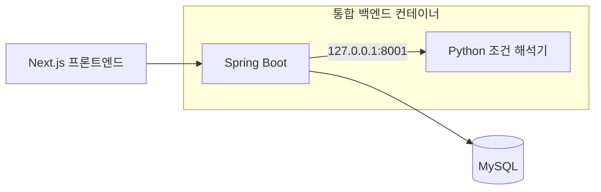

# 백엔드와 조건 해석 통합 이미지

Northflank의 서비스 수 제한을 검토하기 위해 Spring 백엔드와 Python 조건 해석기를 하나의 배포 이미지로 실행한다. 기존 로컬 `compose.yaml`은 두 서비스를 별도 컨테이너로 유지한다. 프론트엔드와 MySQL은 별도로 준비해야 한다.



`Dockerfile.backend-combined`는 기존 임베딩 모델을 이미지 빌드 시 내려받고 Python과 Java를 함께 설치한다. 실행 스크립트는 조건 해석기를 컨테이너 내부 loopback에만 열고 두 프로세스 중 하나가 종료되면 나머지도 종료한다. 플랫폼의 `PORT`는 별도 `SERVER_PORT`가 없을 때 Spring 포트에 적용된다.

```powershell
docker build -f Dockerfile.backend-combined -t teamup-backend-combined .
```

배포 시 `DB_URL`, `DB_USERNAME`, `DB_PASSWORD`, OAuth 프로필과 인증 정보를 환경변수로 설정한다. 프론트엔드의 API 및 OAuth 프록시 주소와 제공자 callback도 실제 배포 주소에 맞춰야 한다. 위 이미지는 DB를 포함하지 않는다.

로컬 Docker 검증에서 임시 MySQL을 사용해 Spring 기동과 마이그레이션, 지정된 `PORT` 연결, 실제 임베딩 추론, 정상 종료를 확인했다. 추론 직후 측정된 통합 컨테이너 메모리는 약 1.19 GiB였으며 부하 테스트 결과나 필요 메모리의 상한은 아니다.

Northflank 무료 메모리 및 빌드 제한, 배포 DB 연결, 실제 OAuth와 브라우저 동작은 별도로 확인해야 한다. 이미지 빌드는 테스트를 건너뛰므로 CI에서 테스트를 별도로 실행한다. GitHub Actions 및 Northflank 배포 설정은 아직 포함하지 않는다.

## 새 운동 일정 푸시 활성화

1. 운영자 PC에서 `npx web-push generate-vapid-keys`를 한 번 실행합니다. 생성한 키 쌍은 배포할 때마다 같은 값을 사용합니다.
2. Fly.io에서 백엔드 앱 `teamup-hrwc-g`의 **Secrets**에 아래 세 값을 등록하고 **Deploy Secrets**를 누릅니다.

   | 이름 | 값 |
   | --- | --- |
   | `WEB_PUSH_PUBLIC_KEY` | 생성한 Public Key |
   | `WEB_PUSH_PRIVATE_KEY` | 생성한 Private Key |
   | `WEB_PUSH_SUBJECT` | `mailto:`로 시작하는 운영자 이메일 주소 |

3. 백엔드와 프론트엔드를 배포합니다. 백엔드가 시작되면 Flyway가 구독 테이블을 만들고, 프론트엔드는 로그인한 사용자의 요청으로 공개 키를 가져옵니다.
4. 휴대폰에서 **운동 일정 투표 → 가입한 모임의 새 일정 알림 받기**를 누릅니다. 테스트 모임에서 새 투표를 등록한 뒤 알림을 눌러 해당 투표가 열리는지 확인합니다.
