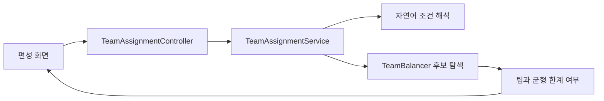

# 팀 편성 탐색 구현

`TeamAssignmentService`는 권한·참석자 검증과 조건 해석 후 탐색을 호출한다. `TeamBalancer`는 같은 팀 그룹을 묶고 다른 팀 조건과 팀 정원을 지키는 후보를 최대 5초 동안 탐색한다. 탐색을 끝내면 즉시 반환하고, 시간 초과 시에는 이미 찾은 최선의 유효 후보를 반환한다. 유효 후보가 없으면 완전 탐색으로 확인한 조건 충돌과 시간 초과를 구분한다.

평균은 저장 rating을 10으로 나눈 화면 단위의 반올림 전 값이다. 평균 차이가 0.8 미만인 후보가 있으면 포지션 분포를 먼저 비교하고, 없으면 평균 차이를 먼저 비교한다. 포지션 점수는 각 세부 포지션과 계열별로 팀 내 인원 비율을 구하고, 팀 쌍마다 비율 차이의 제곱을 합산한다. 세부 포지션에는 가중치 4, 계열에는 1을 적용하며 합이 작을수록 고르게 평가한다. 이 점수는 필수 배치 조건이 아니다.

화면의 진행률은 요청 시작 후 경과 시간을 5초 기준으로 표시한 추정치다. 인증 확인과 전송 시간이 포함되므로 서버 탐색 경과 시간과 정확히 일치하지 않는다. 응답 전에는 99%에서 대기한다. 전체 탐색 완료나 전체 최적해는 보장하지 않는다.
